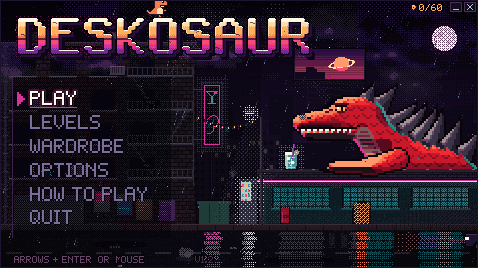
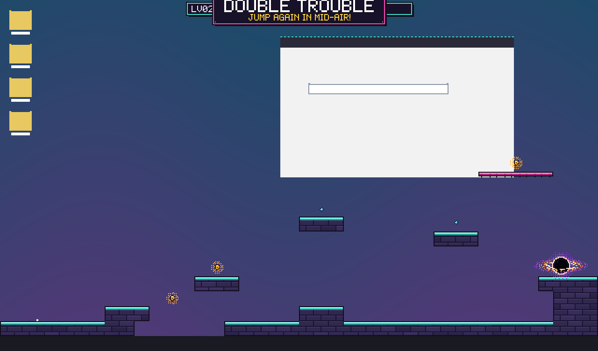

<div align="center">



# DESKOSAUR

**A pixel dino platformer that runs on your actual Windows desktop.**
Jump across 20 levels and across your desktop icons, window title bars and Chrome text boxes.

### [⬇ Download for Windows](../../releases/latest)

<sub>Windows 10 / 11 · ~200 KB · nothing else to install</sub>

</div>

---

<div align="center">

</div>

## How to play

1. Grab **Deskosaur.zip** from the [latest release](../../releases/latest) and unzip it.
2. Double-click **`Install Deskosaur.bat`** (no admin needed).
3. Press the **Windows key**, type **Deskosaur**, and hit Enter.

> Windows may show *"Windows protected your PC"* because the game isn't code-signed.
> Click **More info → Run anyway**. Uninstall any time from **Settings → Apps**.

| Key | Action |
| --- | --- |
| ← → / A D | Run |
| Space / ↑ / W | Jump (press again mid-air to double jump) |
| ↓ / S | Drop through planks |
| R | Restart level |
| Esc / P | Pause (frees your keyboard so you can type) |

## Your desktop is part of the level

The dino can land on anything with an edge: **window title bars**, **desktop icons**, and stuff *inside* windows like **text boxes, buttons, tabs, links and Explorer files**. Glowing lines show where you can land. While a level runs, the game is fully click-through, so you can drag a window under the dino to build a bridge, and it rides along.

Every level is beatable **without** the desktop. A solver bot plays each level using the real game physics to prove it. Your desktop just hands you shortcuts.

## Features

- **4 dinos:** Rex, Bronto, Steggy and Trike, with hats, glasses, shirts and shoes (rocket boots shoot flames!)
- **20 levels** across 4 worlds: Neon Alley, Frost Byte, Fan Factory, Event Horizon
- Double jump, slippery ice, up-drafts and side fans, springs, crumbling blocks, conveyor belts, moving platforms, portals, jump-refill orbs, spikes and checkpoints
- **60 amber pieces** to find, which unlock new gear
- A black-hole exit that catches you, holds you up, and spins you in
- A rainy neon launcher with a chiptune soundtrack
- Tiny and light: a software renderer with a ~1 MB framebuffer and no engine or runtime downloads

## Build from source

No Visual Studio needed. Run **`build.bat`**, which uses the C# compiler that ships with Windows (`C:\Windows\Microsoft.NET\Framework64\v4.0.30319\csc.exe`). Plain C# 5 + WinForms.

```
src/Core   engine: renderer, pixel art, physics, levels, particles, launcher, chiptune synth
src/Win    Windows bits: transparent overlay, keyboard hook, audio, desktop scanner (UI Automation)
setup      installer / uninstaller scripts
tools      level-solver bot and preview renderers (dev only)
```

Levels are ASCII maps in [`src/Core/Levels.cs`](src/Core/Levels.cs). The legend is at the top if you want to make your own.

Pushing a tag like `v1.3` makes GitHub Actions compile the game on Windows and attach a fresh `Deskosaur.zip` to a new release.

## License

[MIT](LICENSE)
